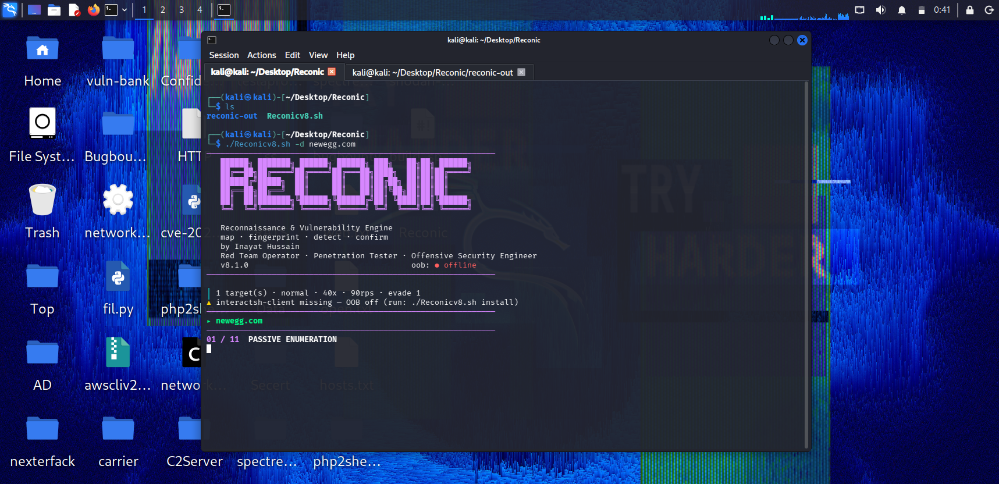

<div align="center">

```
   ██████╗ ███████╗ ██████╗ ██████╗ ███╗   ██╗██╗ ██████╗
   ██╔══██╗██╔════╝██╔════╝██╔═══██╗████╗  ██║██║██╔════╝
   ██████╔╝█████╗  ██║     ██║   ██║██╔██╗ ██║██║██║
   ██╔══██╗██╔══╝  ██║     ██║   ██║██║╚██╗██║██║██║
   ██║  ██║███████╗╚██████╗╚██████╔╝██║ ╚████║██║╚██████╗
   ╚═╝  ╚═╝╚══════╝ ╚═════╝ ╚═════╝ ╚═╝  ╚═══╝╚═╝ ╚═════╝
```

### Reconnaissance & Vulnerability Engine

**map · fingerprint · detect · confirm**

by **Inayat Hussain** — Red Team Operator · Penetration Tester · Offensive Security Engineer


<br>



<sub>Reconic v8.1 — passive enumeration phase, Kali Linux</sub>

</div>

---

## What this is

Reconic is an attack-surface mapping and vulnerability detection framework for authorised bug bounty and penetration testing. It runs a nine-phase pipeline from passive enumeration through to confirmed findings, with an out-of-band listener wired into every blind vector.

It is not a wrapper that pipes URLs into nuclei and calls it a day. Every module carries its own payload corpus, its own differential logic, and its own false-positive gate.

**v8 is a full rewrite.** The v1 script was a linear five-step shell loop. v8 is a concurrent, modular engine with confidence grading, callback correlation, and regression diffing.

---

## Core capabilities

| Area | Detail |
|---|---|
**Subdomain enumeration** | subfinder, assetfinder, crt.sh, AlienVault OTX, plus optional DNS brute force |
**Fingerprinting** | httpx tech-detect, server banner, CDN, CNAME, TLS, JARM, favicon hash |
**Crawling** | katana (JS-aware), gau, waybackurls, Common Crawl CDX, subjs |
**Parameter intelligence** | 11 classified buckets — LFI, RCE, IDOR, SQLi, XSS, SSRF, redirect, SSTI, XXE, upload, API |
**Detection modules** | 19 modules, 380+ encoded payloads, 3-level WAF evasion |
**OOB engine** | interactsh listener, token-per-injection, callback correlation |
**Content discovery** | directory brute force, vhost fuzzing, parameter fuzzing via ffuf with auto-calibration |
**Regression diffing** | compare two runs, report only newly appeared hosts and endpoints |
**Reporting** | severity/confidence triage, Markdown report, JSONL export |

---

## Detection modules

**Parameter modules** — run against every parameterised URL.

| Module | Method | Confirmation |
|---|---|---|
`xss` | canary + quote breakers + OOB script tag | raw reflection absent from baseline, HTML content-type gate |
`sqli` | error injection, boolean pair, `SLEEP(3)` | DB error signature, length divergence, timing delta measured twice |
`lfi` | 5 traversal depths, wrappers, null bytes | `root:x:0:0`, base64 PHP marker |
`rce` | 8 separators, command substitution, OOB | `uid=…gid=` regex, callback |
`ssti` | 7 template dialects incl. engine-specific RCE | `49` arithmetic, `7777777` concat |
`ssrf` | metadata IPs, loopback, gopher, dict, file | `ami-id`, `root:x:0:0`, OOB callback |
`redirect` | protocol-relative, scheme-relative, `@`-trick | `Location:` header inspection |
`crlf` | `%0d%0a` variants | injected header in response |
`idor` | adjacent numeric ID comparison | dual 200 + length delta |
`jwt` | `alg:none` forge + 10k secret dictionary | token accepted, HMAC match |
`xxe` | file entity, PHP filter, OOB parameter entity | entity expansion, callback |

**Host modules** — run against every live host.

| Module | Detail |
|---|---|
`exposure` | 28 paths: `.git/HEAD`, `.env`, `actuator/env`, `actuator/heapdump`, `v2/api-docs`, `backup.zip`, `db.sql` and more |
`cors` | origin reflection, credentials, `null` origin |
`hosthdr` | `Host` and `X-Forwarded-Host` reflection |
`takeover` | 14 dangling CNAME fingerprints with provider error-page matching |
`tls` | expired, self-signed, hostname mismatch |
`dir` | ffuf directory brute with extension matrix |
`vhost` | `Host: FUZZ` fuzzing with baseline-size filtering |

---

## Install

```bash
git clone https://github.com/InayatHussain09/reconic.git
cd reconic
chmod +x Reconicv8.sh
./Reconicv8.sh install
./Reconicv8.sh verify
```

`install` resolves the package manager, builds the Go toolchain into `$GOPATH/bin`, stages wordlists into `~/.reconic/wordlists`, and pulls current nuclei templates.

---

## Usage

```bash
# single target, full pipeline
./Reconicv8.sh -d example.com

# scoped program list, high concurrency
./Reconicv8.sh -t scopes.txt -c 60

# content discovery with a custom wordlist
./Reconicv8.sh -d example.com --dir --vhost -w ~/wl/raft.txt

# detection only, high severity and above
./Reconicv8.sh -d example.com --modules xss,sqli,ssrf,rce --sev high

# OSINT only, zero active traffic
./Reconicv8.sh -d example.com --passive

# compare against a previous run
./Reconicv8.sh -d example.com --diff ./reconic-out/2026-10-01

# standalone diff
./Reconicv8.sh diff ./reconic-out/old ./reconic-out/new

# stdin
cat scopes.txt | ./Reconicv8.sh --passive
```

---

## Flag reference

| Flag | Meaning |
|---|---|
`-d <domain>` | single target |
`-t <file>` | target list (`-l` alias) |
`-w <file>` | wordlist for dir / vhost / sub-brute |
`-o <dir>` | output root (default `./reconic-out`) |
`-p <profile>` | `light` · `normal` · `deep` |
`-c <n>` | concurrency (default 40) |
`-r <n>` | requests per second (default 90) |
`--evade <0-3>` | WAF evasion level |
`--modules a,b` | run only these modules |
`--skip a,b` | exclude these modules |
`--sev <level>` | report floor: `low` · `medium` · `high` · `critical` |
`--dir` `--vhost` `--fuzz` `--subs-brute` | enable content discovery |
`--diff <dir>` | diff against a stored run |
`--scope <regex>` | keep only matching hosts |
`--exclude <regex>` | drop matching hosts |
`--passive` | no active traffic |
`--no-oob` `--no-confirm` `--no-crawl` `--no-nuclei` | disable subsystems |
`--resume` `--jsonl` `--debug` `-q` `-s` | runtime control |

---

## Profiles

| Profile | Concurrency | Rate | Crawl | Brute | Use case |
|---|---|---|---|---|---|
`light` | 8 | 20 req/s | no | no | 4 GB VPS, shared bandwidth |
`normal` | 40 | 90 req/s | yes | no | default |
`deep` | 70 | 140 req/s | yes | yes | dedicated box, full run |

---

## Out-of-band engine

When `interactsh-client` is present, a listener starts before the first request and every blind payload gets a unique token subdomain:

```
http://r7f3a91c.<your-oast-domain>/
><script src=//r9d2b04e.<your-oast-domain>></script>
```

Each callback is matched back to the exact URL and parameter, and written as a `firm` finding. The listener is torn down on exit or `Ctrl-C`.

Blind SSRF, blind XSS, blind RCE, and blind XXE all depend on this. Disable with `--no-oob`.

---

## False-positive discipline

Detection without confirmation is noise. Reconic enforces four gates:

1. **Baseline capture** — every URL is fetched once before mutation; signatures present in the baseline never count.
2. **Soft-404 calibration** — a random path is requested first, and any response within ±25 bytes of it is discarded.
3. **Dual-payload confirmation** — boolean SQLi requires both the true and false branch to behave differently.
4. **`--confirm` re-request** — every candidate is re-fetched before it reaches the report.

Findings carry confidence: `firm` (reproduced or callback), `probable` (differential signal), `soft` (heuristic). Filter with `--sev`.

---

## Output layout

```
reconic-out/
├── _logs/                      per-target and global logs
├── _oob.jsonl                  raw callback stream
└── <target>/
    ├── subs.txt  resolved.txt  live.txt  live2xx.txt
    ├── fingerprint.txt  tech.txt  waf.txt
    ├── urls.txt  param_urls.txt
    ├── findings.tsv            raw, all severities
    ├── findings.txt            filtered + sorted
    ├── REPORT.md               triage table
    ├── findings.jsonl          machine-readable (--jsonl)
    └── diff/                   new_* / gone_* vs baseline
```

---

## Requirements

Bash ≥ 4.0, Go ≥ 1.21, `curl`, `jq`, Python 3, `interactsh-client`. Full manifest in [`requirements.txt`](requirements.txt).

macOS ships Bash 3.2 — `brew install bash` first.

---

## v8 changelog

**Added** — interactsh OOB engine · 380+ payload corpus · 3-level WAF evasion · 14 WAF fingerprints · vhost fuzzing · directory brute force · parameter fuzzing · regression diff engine · `--scope` / `--exclude` · `--debug` · JSONL export · soft-404 calibration · confidence grading · `--confirm` verification pass · 11-module expansion.

**Fixed** — `awk` ternary parsed as redirection · `tr` mangling multibyte block glyphs · apex dropped on DNS failure · no httpx retry path · banner printed after first error · httpx stderr discarded.

**Changed** — `-t` is now targets, `-c` is concurrency · `-w` added for wordlists · profile defaults retuned.

---

## Legal

Run only against in-scope assets. Defaults are conservative — 40 concurrent, 90 req/s, 14 s timeouts. Use `--passive` for programs with strict rate rules.

---

<div align="center">

**Inayat Hussain**
Red Team Operator · Penetration Tester · Offensive Security Engineer

MIT License

</div>
